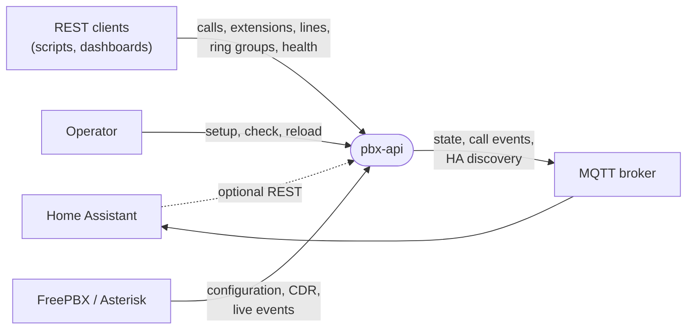
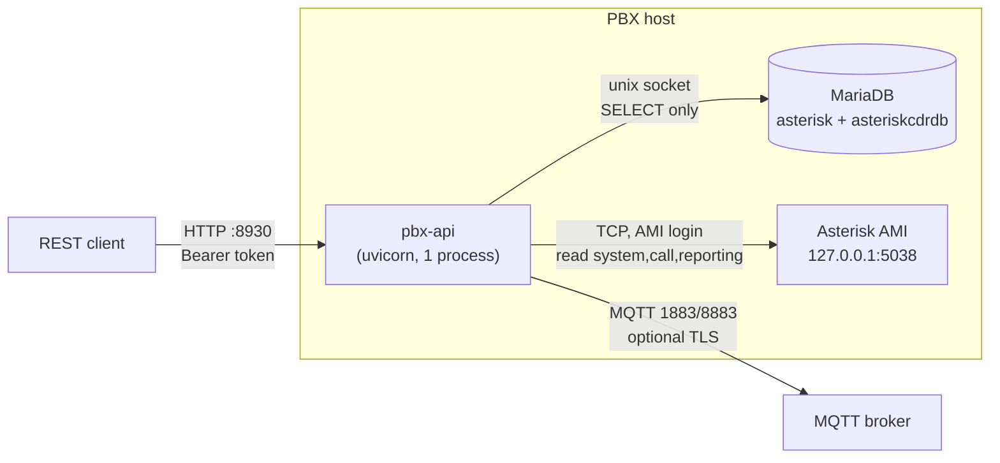
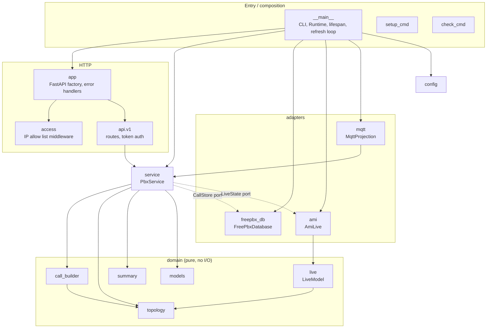
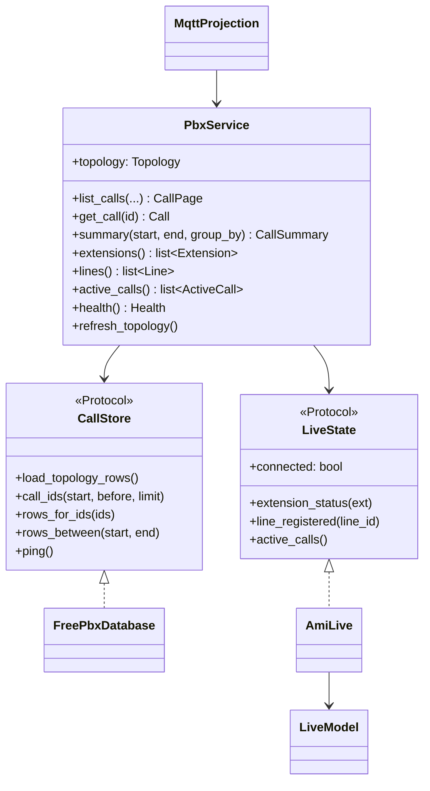
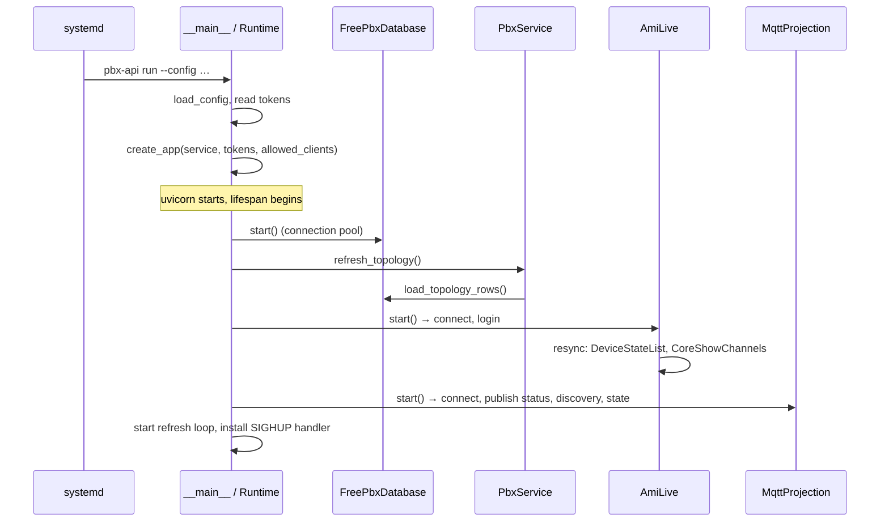
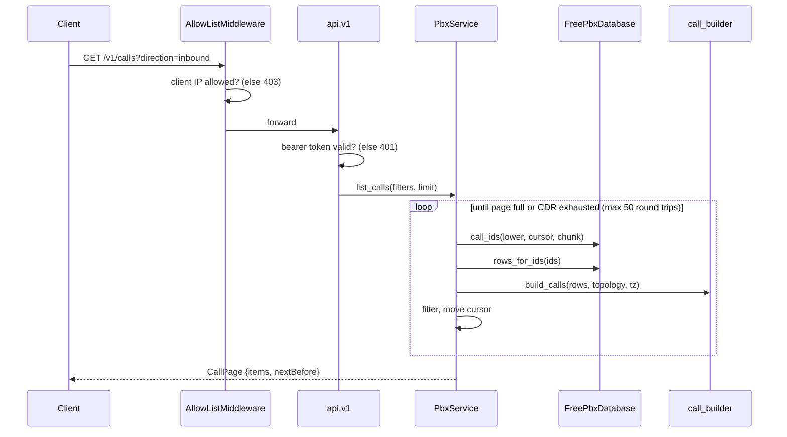
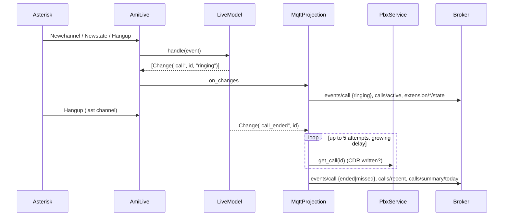
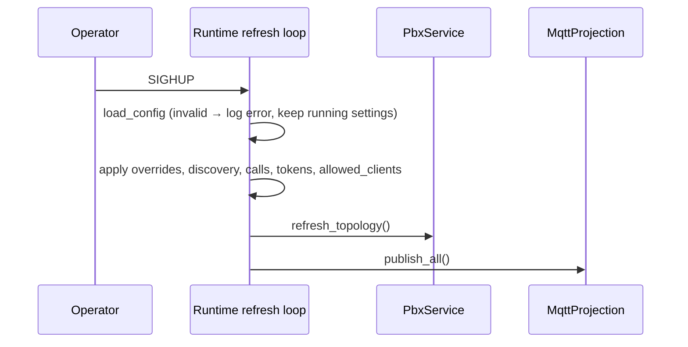
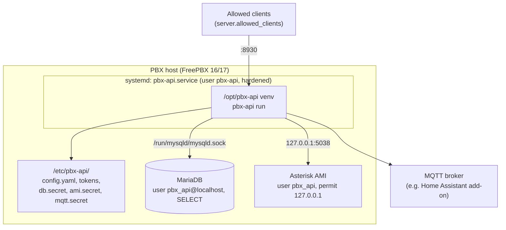
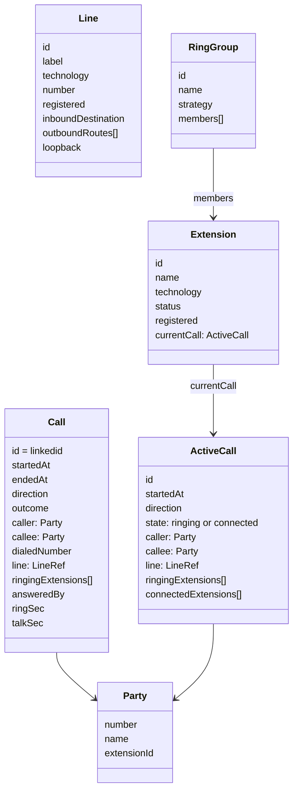

# pbx-api – Architecture

This document follows the [arc42](https://arc42.org) template. It describes the
current state of the code; keep it in sync with every change (see
[Keeping this document current](#keeping-this-document-current)).

Usage, installation and configuration are in the [README](README.md); the REST
contract is [`openapi.yaml`](openapi.yaml); MQTT topics are in
[docs/mqtt.md](docs/mqtt.md).

---

## 1. Introduction and goals

pbx-api runs on a FreePBX/Asterisk host and exposes the phone system as a
**business interface**: calls as people experience them, extensions, external
lines and ring groups. It offers a REST API (OpenAPI contract) and an MQTT
projection with Home Assistant discovery.

### Requirements overview

| # | Requirement |
|---|---|
| R1 | A *call* is the business event, not a CDR leg: all legs of one call (ring groups, follow-me, loopback routes, gateway duplicates) are merged; direction, outcome, line, ringing and answering extensions are derived. |
| R2 | Call history with filters, paging and summaries via REST. |
| R3 | Live state: extension status and registration, line registration, calls in progress. |
| R4 | Push of state and call events via MQTT, auto-discovered by Home Assistant. |
| R5 | Zero installation-specific code: extensions, lines, DIDs, ring groups, routes and the phone book are discovered from FreePBX. |
| R6 | Simple, idempotent installation on the PBX host (`pbx-api setup`). |

### Quality goals

| Priority | Quality | Motivation |
|---|---|---|
| 1 | **Security / least privilege** | Runs on the PBX itself; must never be able to change PBX state. |
| 2 | **Correctness of the call model** | Users judge the service by whether "missed call from X" is true. |
| 3 | **Robustness** | Database, AMI or broker outages degrade the service, never crash it. |
| 4 | **Contract stability** | Clients (Home Assistant, scripts) depend on the REST and MQTT shapes. |
| 5 | **Operability** | Configuration reload without restart, a `check` command, a hardened systemd unit. |

### Stakeholders

| Role | Expectation |
|---|---|
| PBX operator | Easy install/upgrade, no risk to the running PBX, no secrets in the repo. |
| Home Assistant user | Entities appear automatically; reliable call events for automations. |
| API client developer | A stable, documented contract with problem-detail errors. |
| Contributor | Clear module boundaries, pure domain logic testable without a PBX. |

## 2. Architecture constraints

| Constraint | Consequence |
|---|---|
| FreePBX 16/17, Asterisk 18+, CDR in MariaDB | Data access via the FreePBX MariaDB schema (`asterisk`, `asteriskcdrdb`). |
| Python 3.11+ on the PBX host | Pure-Python dependencies only; installed into a venv from the Git repository (no PyPI release). |
| Runs on the PBX host | Database via unix socket, AMI via `127.0.0.1` only. |
| Read-only towards the PBX | DB user with `SELECT` only on the tables listed in `READ_TABLES`; AMI user with write class `reporting` (informational actions only). |
| Apache-2.0, permissive dependencies only | Enforced by `scripts/check_licenses.sh`. |
| No installation data in the repository | `scripts/leak-check.sh` in the pre-commit and pre-push hooks with a personal denylist kept outside the repo; test data is synthetic. |

## 3. Context and scope

### Business context

| Partner | Input to pbx-api | Output from pbx-api |
|---|---|---|
| FreePBX / Asterisk | Topology (extensions, trunks, DIDs, ring groups, routes, phone book), CDR rows, AMI events | – (read only) |
| REST clients | HTTP requests with bearer token | JSON (OpenAPI), RFC 9457 problem details |
| MQTT broker / Home Assistant | – | Retained state topics, call events, discovery configs |
| Operator | `config.yaml`, secrets, `SIGHUP` | Logs, `check` output |

### Technical context

## 4. Solution strategy

| Goal | Approach |
|---|---|
| Business-level calls (R1) | Group CDR rows by `linkedid`, derive direction/outcome from channels matched against the discovered topology, merge gateway duplicates within a time window (`calls.dedup_window_sec`). |
| Live state (R3) | Keep an in-memory model fed by AMI events; resync from `DeviceStateList` + `CoreShowChannels` after every (re)login. |
| Push (R4) | MQTT is a *projection* of the same service methods the REST API uses; nothing is computed only for MQTT. |
| Zero configuration (R5) | Topology loaded from FreePBX at start, every `discovery.refresh_sec` and on `SIGHUP`; YAML holds only connections and display overrides. |
| Testability | Hexagonal layering: pure domain (`domain/`) without I/O; adapters behind `typing.Protocol` ports (`CallStore`, `LiveState`). |
| Security | Least-privilege accounts created by `setup`, IP allow list + static bearer tokens, hardened systemd unit. |
| Contract stability | `openapi.yaml` is checked in and a test fails when the code diverges from it. |
| Technology | Python asyncio: FastAPI/uvicorn, aiomysql, panoramisk (AMI), aiomqtt, pydantic. |

## 5. Building block view

### Level 1 – modules

| Module | Responsibility |
|---|---|
| `__main__` | CLI (`run`, `check`, `setup`); `Runtime` wires adapters, service and app; lifespan start/stop; periodic and `SIGHUP`-triggered refresh and config reload. |
| `app` | FastAPI factory; maps errors to RFC 9457 problem details. |
| `access` | Parses allow-list entries (address or CIDR); ASGI middleware returning `403` before any routing or token check; loopback is always allowed. |
| `api.v1` | `/v1` routes; bearer token dependency on everything except `/v1/health`. |
| `service` | `PbxService`: application use cases (list/get calls, summaries, extensions, lines, ring groups, active calls, health); time-zone handling between naive CDR local time and aware API timestamps; paging. |
| `domain.models` | Pydantic models of the public contract (`Call`, `ActiveCall`, `Extension`, `Line`, …). |
| `domain.topology` | Topology built from FreePBX rows plus overrides: channel → line/extension mapping, phone book lookup, DID destinations. |
| `domain.call_builder` | CDR rows → `Call` (grouping, direction, outcome, parties, durations, dedup). |
| `domain.live` | `LiveModel`: AMI events → device states and channels → `ActiveCall`; emits `Change` notifications. |
| `domain.summary` | Counts per period, optionally grouped by day/line/extension. |
| `adapters.freepbx_db` | The *only* module that knows table and column names; read-only queries; optional FreePBX module tables tolerated as empty. |
| `adapters.ami` | panoramisk connection, event dispatch to `LiveModel`, resync on login, reconnect. |
| `adapters.mqtt` | Publishes state, events and HA discovery; outbound queue; reconnect with backoff; periodic republish. |
| `config` | Pydantic configuration from YAML; secrets read from separate files. |
| `setup_cmd` / `check_cmd` | Host preparation (user, secrets, DB grants, AMI user, systemd unit) and connectivity check. |

### Level 2 – ports and adapters

Tests replace `FreePbxDatabase` with an in-memory store (`tests/memory_store.py`)
and feed `LiveModel` with synthetic AMI events.

## 6. Runtime view

### Start-up

### REST: call history

Paging uses the start time of the oldest returned call as cursor (`before`), so
calls merged across several CDR groups never split across pages.

### Live call → MQTT event

A call that was connected once stays `connected` while its legs hang up one by
one, so `answered` is not followed by a spurious second `ringing`.

### Reload (`systemctl reload` → SIGHUP)

Without `SIGHUP` the same loop refreshes only the topology every
`discovery.refresh_sec` seconds. Connection settings (DB, AMI, MQTT, bind/port)
require a restart.

## 7. Deployment view

| Element | Notes |
|---|---|
| Installation | `pip install git+<repo>@<tag>` into `/opt/pbx-api`, then `pbx-api setup` (idempotent, `--dry-run`). |
| Secrets | Generated by `setup`, never overwritten, `/etc/pbx-api` mode 750; files referenced from `config.yaml`. |
| systemd unit | `ProtectSystem=strict`, `NoNewPrivileges`, empty capability set, `AF_UNIX/INET/INET6` only; `ExecReload` sends `SIGHUP`. |
| Network | uvicorn binds `server.bind:server.port` without TLS; `X-Forwarded-For` is ignored. A host firewall may add another layer. |

## 8. Cross-cutting concepts

### Domain model

`direction` is `inbound`, `outbound` or `internal`; `outcome` is `answered`,
`missed` (inbound), `no_answer`, `busy` or `failed`.

### Call derivation rules

* **Grouping:** CDR rows with the same `linkedid` form one call.
* **Direction:** inbound if a non-loopback trunk channel originates a leg;
  outbound if a trunk is a destination channel; otherwise internal.
  Loopback trunks (local channels into a context) are not treated as inbound.
* **Outcome precedence:** answered > busy > failed/congestion > missed (inbound)
  or no_answer (outbound/internal).
* **Gateway duplicates:** calls with equal direction, caller, dialed number and
  line starting within `dedup_window_sec` are merged; the "best" outcome wins.
* **Names:** caller ID name, then phone book (matched on the last
  `phonebook_match_digits` digits), then extension/ring-group names, then overrides.

### Time

CDR timestamps are naive local time of the PBX. `PbxService` converts at the
boundary: API and MQTT always use RFC 3339 with offset; the time zone is
`freepbx.timezone` or the system zone (DST aware).

### Security

1. `AllowListMiddleware`: client IP (TCP peer) against `server.allowed_clients`
   plus loopback; applies to every path including `/v1/health` and `/docs`.
2. Bearer token from `server.tokens_file` on all `/v1` routes except health.
3. Least privilege towards the PBX (see section 2); secrets never in the YAML.
4. Allow list and tokens are hot-reloadable; an invalid file is rejected as a whole.

### Error handling and resilience

* REST errors are RFC 9457 `application/problem+json`.
* `/v1/health` reports `degraded` when DB, AMI or MQTT is down; the service keeps serving.
* AMI: panoramisk reconnects; every login triggers a full resync; one bad event
  is logged, never fatal.
* MQTT: reconnect with exponential backoff (max 60 s), last will `offline`,
  retained state republished on reconnect.
* Missing optional FreePBX module tables are treated as empty.

### Configuration

Pydantic models in `config.py`; YAML for structure, separate files for secrets;
display overrides (`overrides.*`) only adjust names/labels and hide entries.

### Testing

| Test | Scope |
|---|---|
| `test_call_builder` | CDR → calls, synthetic fixtures (`tests/fixtures.py`). |
| `test_live` | AMI event sequences → live state and changes. |
| `test_api` | HTTP endpoints against an in-memory store. |
| `test_access` | Allow-list parsing and middleware. |
| `test_mqtt` | Topics, payloads, discovery. |
| `test_contract` | Generated OpenAPI == checked-in `openapi.yaml`. |
| `test_setup` | Setup planning and file generation. |

## 9. Architecture decisions

| # | Decision | Rationale | Consequence |
|---|---|---|---|
| ADR-1 | Read FreePBX data directly from MariaDB | Complete, fast, available on every FreePBX; no dependency on FreePBX API modules. | Coupling to the schema; confined to `adapters/freepbx_db.py`. |
| ADR-2 | Use AMI events for live state | Only source of real-time device and channel state. | Needs an AMI user; resync logic on reconnect. |
| ADR-3 | Discover topology instead of configuring it | No drift between PBX and service; nothing installation-specific in code or repo. | Overrides only for display; refresh loop. |
| ADR-4 | Hexagonal layering with Protocol ports | Domain logic testable with synthetic data, no PBX required. | Slight indirection in `PbxService`. |
| ADR-5 | Checked-in OpenAPI contract enforced by a test | Contract changes become explicit in review. | Regenerate with `scripts/export_openapi.py` after API changes. |
| ADR-6 | MQTT as projection of the service | One source of truth for REST and MQTT payloads. | MQTT payloads follow the REST models. |
| ADR-7 | IP allow list + static bearer tokens | Small LAN deployments; no identity provider needed. | No per-user authorization; rotation by editing `tokens` and reloading. |
| ADR-8 | Asyncio single process | Low footprint on the PBX; I/O bound workload. | Blocking code must be avoided in handlers. |
| ADR-9 | Install from Git, `setup` command on host | No PyPI publication needed; reproducible host preparation. | `setup` must stay idempotent. |

## 10. Quality requirements

| Scenario | Quality | Expected response |
|---|---|---|
| A caller rings a ring group of three phones, one answers | Correctness | One `Call`, `outcome=answered`, three `ringingExtensions`, `answeredBy` set. |
| The trunk gateway delivers one call twice | Correctness | One call after dedup. |
| A request arrives from an IP not on the allow list | Security | `403` before token check, rate-limited warning in the log. |
| The broker is down for 10 minutes | Robustness | REST unaffected, health `degraded`; state republished after reconnect. |
| Asterisk restarts | Robustness | AMI reconnects, live model resynced, MQTT receives a full republish. |
| Operator adds an extension in FreePBX | Operability | Visible after the next refresh or `systemctl reload pbx-api`, no restart. |
| Operator saves an invalid `config.yaml` and reloads | Operability | Error logged, running settings kept. |
| A code change alters a response model | Contract | `test_contract` fails until `openapi.yaml` is regenerated. |

## 11. Risks and technical debt

| Risk / debt | Impact | Mitigation |
|---|---|---|
| FreePBX schema or CDR semantics change between versions | Wrong or missing data | Schema confined to one adapter; optional tables tolerated; `pbx-api check`. |
| Call derivation is heuristic (channel names, dedup window) | Rare misclassification | Fixture-based tests; configurable window. |
| Finished call published only once the CDR is readable (polling, ~22 s max) | Late or missing `ended` event | Logged; `calls/recent` republished anyway. |
| History filters are applied after building calls | Many round trips for sparse filters | Hard bound of 50 round trips per request. |
| No TLS in the service itself | Tokens visible on the LAN | Bind to localhost or use a reverse proxy / trusted network. |
| Static tokens without scopes | Every token has full read access | Read-only API; IP allow list. |

## 12. Glossary

| Term | Meaning |
|---|---|
| AMI | Asterisk Manager Interface, TCP event/action protocol of Asterisk. |
| CDR | Call Detail Record; one row per call leg in `asteriskcdrdb.cdr`. |
| Leg | One channel-to-channel segment of a call. |
| `linkedid` | Asterisk identifier shared by all legs of one call; the `Call.id`. |
| Line | An external line = FreePBX trunk, with its own number. |
| DID | Direct inward dialing number, routed by an inbound route to a destination. |
| Ring group | FreePBX group of extensions rung together. |
| Loopback trunk | A trunk implemented as a local channel into a dialplan context; not an external line for direction. |
| Topology | The discovered PBX structure: extensions, lines, DIDs, ring groups, routes, phone book. |
| Projection | The MQTT view of the service state. |
| HA discovery | Home Assistant MQTT discovery: config topics that create entities automatically. |

---

## Keeping this document current

Documentation is part of every change. Before each commit, update whatever the
change affects:

* this file – modules, flows, decisions, risks;
* [README.md](README.md) – usage, installation, configuration, access control;
* [docs/](docs/) – MQTT topics, Home Assistant;
* [openapi.yaml](openapi.yaml) – regenerate with `scripts/export_openapi.py`.

The pre-commit hook (`.githooks/pre-commit`) rejects a commit that changes code
or configuration (`src/`, `scripts/`, `.githooks/`, `pyproject.toml`,
`config.example.yaml`) without staging any of these documents. If a change
really has no documentation impact, confirm that explicitly with
`PBX_API_DOCS_CHECKED=1 git commit …`.
